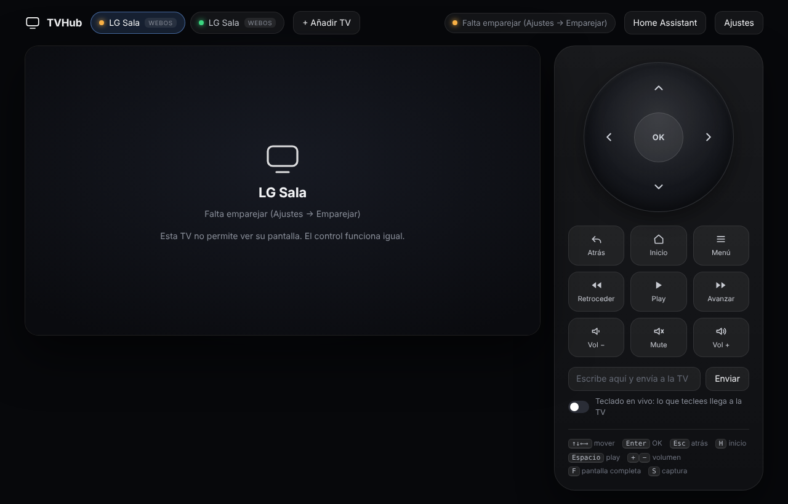

# TVHub

**One web remote for all your TVs — Android TV / Fire TV with a live picture of the screen, LG webOS, and Hisense VIDAA.**
Keep a list of TVs, switch between them with one click (or keys <kbd>1</kbd>–<kbd>9</kbd>). Runs in Docker, opens in your browser.


<sub>The UI above is running against a simulated TV that streams a test pattern.</sub>

## Supported TVs

| Type | Control | Live screen | Apps | Text input | Notes |
|---|---|---|---|---|---|
| **Android** (Fire TV, Google TV / Chromecast, Android TV) | ADB over TCP | ✅ H.264 | ✅ | ✅ | Enable ADB debugging |
| **LG webOS** | Local network (ports 3000/3001), no LG account | ❌ | ✅ | ✅ | Keys, real volume/mute, power off; accept a prompt on the TV once |
| **Hisense VIDAA** | MQTT (port 36669) | ❌ | ❌ | ❌ | Remote keys + volume |

## What it does

- **TV list** — add, rename, edit and delete TVs from the UI; stored in `/data/tvs.json`.
- **Live screen** (Android) — real H.264 video from the TV (`screenrecord`), decoded in the browser with WebCodecs. Not screenshots.
- **Ambient glow** — the light around the picture follows the colour of what's on screen.
- **A proper remote** — D‑pad, Back / Home / Menu, transport, volume. Keyboard: arrows, <kbd>Enter</kbd>, <kbd>Esc</kbd>, <kbd>H</kbd>, <kbd>Space</kbd>, <kbd>+</kbd>/<kbd>−</kbd>.
- **Volume routing** — Fire TV Sticks can't change the TV's volume (HDMI volume is fixed). Set *"Enviar el volumen a"* on the Stick to your Hisense and Vol+/Vol−/Mute go to the TV instead.
- **Live typing**, **app launcher**, **snapshots** (<kbd>S</kbd>), fullscreen (<kbd>F</kbd>) — on Android TVs.

## Quick start

```bash
git clone https://github.com/xavilitoh/tvhub && cd tvhub
docker compose up -d --build
open http://localhost:8080
```

Then click **+ Añadir TV**.

### Android TV / Fire TV
Enable **Developer options → ADB debugging** (Fire TV: *Settings → My Fire TV → About*, click the device name 7 times; then *Developer options → ADB debugging*). Add the TV with its IP, port 5555. The first connection makes the TV ask **"Allow USB debugging?"** — accept with *Always allow*.

### LG webOS
1. On the TV enable *Settings → General → Devices → External devices → LG Connect Apps* (wording varies by year) and keep it on the same network.
2. Add a TV of type **LG webOS** with its IP. A MAC is optional (only to wake it with Wake-on-LAN).
3. Open **Ajustes** on that TV → **Emparejar con la TV** and accept the prompt on the screen within 30 s. The key is kept in `/data/webos-keys.json`.
4. This is the same local protocol Home Assistant's *LG webOS Smart TV* integration uses — not the LG ThinQ cloud account.

### Hisense VIDAA
1. Add a TV of type **Hisense VIDAA**, with its IP and port `36669`.
2. Older models: untick **Conexión cifrada**. Newer models (VIDAA U6/U7 and later) need the TV's **MAC address** (Settings → Network).
3. Open **Ajustes** on that TV → **Mostrar PIN en la TV**, type the PIN, **Emparejar**. Tokens are kept in `/data/vidaa-tokens.json`.
4. Enable the TV's *Remote service / Wake on LAN / mobile app control* option if it doesn't answer.

> **Why Docker?** `adb` on macOS is blocked from reaching LAN devices by *Local Network* privacy (`No route to host`). Inside a Linux container it isn't. If you still see it with Docker Desktop, allow **Docker** under *System Settings → Privacy & Security → Local Network*.

## Home Assistant

Two parts, use either or both. Both land on the **same device** in Home Assistant.

### 1. MQTT: buttons, app picker, text, sensors

TVHub publishes every TV to Home Assistant over **MQTT discovery** — no custom component, no HACS. Each TV becomes a device with:

- **Buttons:** d-pad, OK, back, home, menu, play/pause, rewind/forward, volume ±, mute, power.
- **Abrir app** (a select) with the TV's apps, and **Escribir texto** (a text box) where the TV supports them.
- **Sensors:** state, current app, volume (LG / Hisense), and a *Conectada* connectivity sensor.

Setup:
1. In Home Assistant, install the **Mosquitto broker** add-on and the **MQTT** integration (*Settings → Devices & services*). Create a user for TVHub (*Settings → People*, or a Mosquitto login).
2. In TVHub click **Home Assistant** in the top bar, enter the broker's IP (your Home Assistant), port, user and password, and press **Guardar y conectar**. The dot turns green when it's connected; if not, it tells you why.
3. The TVs appear under *Settings → Devices & services → MQTT*. Add, rename or delete a TV in TVHub and Home Assistant follows.

Use them in automations like any button, e.g. `button.press` on *Subir volumen*, or `select.select_option` on *Abrir app*. Volume routing still applies: a Fire Stick set to send volume to your LG sends the *Subir volumen* press to the LG.

Settings are saved in `/data/ha.json` (readable only by the TVHub user, password included). Instead of the web form you can seed them with the `MQTT_*` variables in `docker-compose.yml`; what you save in the web form wins. `GET /api/ha` reports the connection state. Optional variables: `MQTT_TLS=1`, `MQTT_TLS_INSECURE=1`, `HA_DISCOVERY_PREFIX` (default `homeassistant`), `MQTT_PREFIX` (default `tvhub`), `TVHUB_URL` (adds a link to TVHub on each device).

### 2. Integration: a real `media_player`

MQTT can't create `media_player` entities, so TVHub also ships a small Home Assistant integration (`custom_components/tvhub`). It gives every TV a **media_player** with on/off, volume (slider, steps, mute), play/pause/stop/rewind/forward, and the **app list as sources** — it works with the standard media control card, voice assistants and automations (`media_player.select_source`, `media_player.volume_set`…).

1. Let Home Assistant reach TVHub: create a `.env` file next to `docker-compose.yml` (it is git-ignored) with `TVHUB_BIND=0.0.0.0` and `TVHUB_TOKEN=<a long random string>` (e.g. `openssl rand -hex 16`), then `docker compose up -d --build`. Open the web UI once as `http://localhost:8080/?token=<token>`.
2. Install the integration with **HACS**: [](https://my.home-assistant.io/redirect/hacs_repository/?owner=xavilitoh&repository=tvhub&category=integration)
   or by hand: HACS → ⋮ → *Custom repositories* → `https://github.com/xavilitoh/tvhub`, category **Integration** → *Download* → restart Home Assistant. (Without HACS, copy `custom_components/tvhub` into your `config/custom_components/`.)
3. *Settings → Devices & services → Add integration → TVHub*: the IP of the machine running TVHub, port 8080, and the token.

State refreshes every 3 s. *Volume set* works on LG and Hisense; a Fire Stick whose volume goes to your LG/Hisense (see *Volume routing*) shows and controls that TV's volume. *Turn on* uses Wake-on-LAN on LG (give TVHub the TV's MAC) and wake/sleep keys on Android TV.

### 3. Remote card for your dashboard

The integration also ships a card with the same remote as the web UI: d‑pad, OK, Back / Home / Menu, transport and volume. Hold an arrow or a volume key and it repeats. It is loaded automatically — no resource to add.

```yaml
type: custom:tvhub-remote
entity: media_player.lg_sala      # any TVHub media_player
# optional: name, show_power, show_volume, show_media
```

You can also pick it from *Add card → TVHub Remote* and fill it in with the visual editor. After updating through HACS, restart Home Assistant and hard‑refresh the browser (Ctrl/Cmd+Shift+R) so the new card file is loaded.

The keys go through a service you can use in automations and scripts too:

```yaml
action: tvhub.send_key
target: { entity_id: media_player.lg_sala }
data: { key: HOME }               # DPAD_UP, DPAD_CENTER, BACK, MENU, MEDIA_PLAY_PAUSE, VOLUME_UP…
```

## Upgrading from the old name (TVDeck)

The project used to be called TVDeck. Your TV list, ADB key and pairings live in the Docker volume `tvdeck-data`; the new volume is `tvhub-data`. Copy it once before starting the new container:

```bash
docker compose -p tvdeck down                      # in the old folder
docker volume create tvhub-data
docker run --rm -v tvdeck-data:/from -v tvhub-data:/to busybox cp -a /from/. /to/
docker compose up -d --build                       # in the new folder
```

`TVDECK_TOKEN` is still read if `TVHUB_TOKEN` is not set. The Home Assistant MQTT bridge withdraws its old `tvdeck_*` entities the first time it connects.

## Open it from another device

Use `http://localhost:8080` on the machine running Docker. Browsers only enable WebCodecs on `localhost` and HTTPS; over plain `http://192.168.x.x` the live picture falls back to snapshots. For other devices put it behind HTTPS and **set a token**:

```yaml
ports: ["8080:8080"]
environment:
  TVHUB_TOKEN: "a-long-random-string"   # then open https://…/?token=a-long-random-string once
```

Anyone who can open the page can control your TVs. By default it only listens on `127.0.0.1`.

## How it works

```
Browser ──WebSocket /ws/video?tv=<id> (H.264, one message per frame)──┐
   └──WebSocket /ws/control (keys, text, apps, tv id)─────────────────┤
                                                  TVHub (Python, aiohttp)
                                                    ├─ AndroidDriver ── adb screenrecord / input / monkey ─▶ Android TV
                                                    └─ VidaaDriver ──── MQTT (vidaa-control) ─────────────▶ Hisense
```

- Each TV type is a driver with capability flags; the UI hides what a TV can't do.
- The server splits `screenrecord`'s Annex B stream into pictures and sends one WebSocket message per picture, keyframes carrying SPS+PPS. It releases a buffered picture after 40 ms of silence (static screens), and restarts `screenrecord` every 3 minutes seamlessly.
- Key presses are queued and batched into one `adb shell` call.

## Limits

- **DRM content** (Netflix, Prime Video…) is usually black in the live picture. Control still works.
- **VIDAA and webOS have no live picture** — their protocols don't offer one. VIDAA also has no app list.
- **Latency** is whatever `screenrecord` + Wi‑Fi gives you.
- **Browser:** tested in Chromium only.
- **Text input** is ASCII only.

## Status

v0.4.

- **Tested:** server, framing, multi-TV registry and persistence, volume routing and the whole browser UI, end to end against a simulated ADB (ffmpeg H.264 at ~30 fps in Chromium) a simulated MQTT broker (keys arrive as `KEY_UP`, `KEY_RETURNS`, `KEY_VOLUMEUP`…) a real MQTT broker for the Home Assistant bridge (discovery of 21 entities, button/app/text commands reaching the TV, removal when a TV is deleted, reconnect after a broker restart), and a simulated LG webOS TV (pairing prompt, buttons, volume/mute, app list and launch, text input, key persisted across restarts).
- **Checked on a real Fire TV Stick 4K Max (Fire OS 7):** ADB, key events, `screenrecord`, package list.
- **Not verified against a real Home Assistant:** discovery payloads follow the documented MQTT discovery schema and work against a plain broker, but I could not run Home Assistant itself.
- **Not verified on real hardware:** the LG webOS driver (uses the maintained `aiowebostv` library, but it has only run against a simulator here) and the Hisense/VIDAA driver (pairing, state detection, which keys each firmware accepts — newer firmware may reject or ignore commands), app launching and text input, and the Docker image itself. Reports with your TV model and firmware are very welcome.

## Configuration

| Variable | Default | |
|---|---|---|
| `TV_HOST` | – | Seeds the first Android TV on first start (everything else is edited in the UI) |
| `TV_PORT` | `5555` | Port for that seeded TV |
| `TVHUB_TOKEN` | – | If set, every request needs `?token=…` (stored as a cookie afterwards) |
| `PORT` | `8080` | HTTP port inside the container |
| `MQTT_HOST` | – | Enables the Home Assistant bridge (see above) |
| `MQTT_PORT` / `MQTT_USER` / `MQTT_PASSWORD` | `1883` / – / – | Broker connection |

## License

MIT
