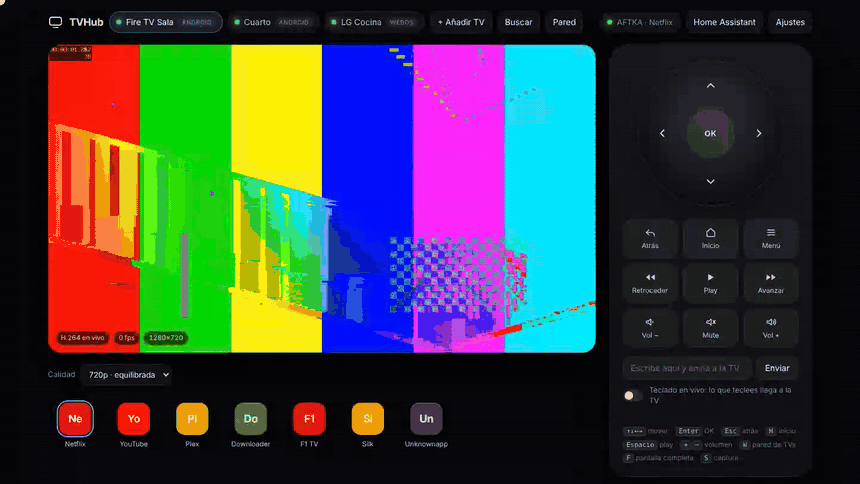

# TVHub

**One web remote for all your TVs — Android TV / Fire TV with a live picture of the screen, LG webOS, Samsung Tizen, Sony Bravia, Roku and Hisense VIDAA.**
Keep a list of TVs, switch between them with one click (or keys <kbd>1</kbd>–<kbd>9</kbd>). Runs in Docker, opens in your browser.


<sub>Recorded against simulated TVs: a test pattern stands in for the screen, and the network search results are mocked. Regenerate it with [docs/demo-src](docs/demo-src).</sub>

## Supported TVs

| Type | Control | Live screen | Apps | Text input | Notes |
|---|---|---|---|---|---|
| **Android** (Fire TV, Google TV / Chromecast, Android TV) | ADB over TCP | ✅ H.264 | ✅ | ✅ | Enable ADB debugging |
| **LG webOS** | Local network (ports 3000/3001), no LG account | ❌ | ✅ | ✅ | Keys, real volume/mute, power off; accept a prompt on the TV once |
| **Samsung Tizen** (2016+) · *experimental* | Local network (WebSocket 8002) | ❌ | ✅ | ❌ | Keys, power; accept a prompt on the TV once. Volume by keys only |
| **Sony Bravia** · *experimental* | Local network (REST + IR codes, port 80) | ❌ | ✅ | ✅ | Needs the *Pre-Shared Key* set on the TV; real volume, HDMI inputs |
| **Roku** (players and Roku TV) · *experimental* | ECP (port 8060), no pairing | ❌ | ✅ | ✅ | Roku TV: power, volume keys and HDMI inputs |
| **Hisense VIDAA** | MQTT (port 36669) | ❌ | ❌ | ❌ | Remote keys + volume |

> **Experimental:** the Roku, Samsung and Sony drivers have only been tested against simulators, not real TVs. If you own one, please open an issue with your model and firmware, whether it works or not.

## What it does

- **All TVs on / off** — the power button at the top right sends the order to every TV in the list at once and tells you which ones did it. Turning on needs the TV to answer over the network (Android with ADB) or its MAC saved for Wake-on-LAN (LG, Hisense). Wake-on-LAN is a broadcast: it does not leave Docker Desktop on macOS / Windows, so there use Linux with `network_mode: host`, or wake those TVs by other means.
- **Wall view** (the home page) — all your TVs at once (<kbd>W</kbd>): a refreshed screenshot for each Android TV, and for the others their state, the app or input in front and the volume. The state updates live: a TV that answers but is asleep shows **En espera**, and the tile's power button turns it on or off accordingly. Click one to open it.
- **Languages** — English, Español, Português, Français and Deutsch. It follows your browser's language (English if yours isn't listed); change it from the ☰ menu. Messages sent by the server for rarer errors may still appear in Spanish.
- **App logos** — each app shows its real logo (fetched once from [Simple Icons](https://simpleicons.org) and cached; LG TVs supply their own). Apps without a known logo keep coloured initials. On TVs without live video (LG, Hisense) the logo of what's playing fills the screen.
- **HDMI inputs** — switch input from the remote on LG, Hisense and Android TV sets (tick *Es una Android TV* in Settings). For a Fire Stick, set the TV it's plugged into and its HDMI port, and **Mostrar en la TV** switches that TV to the stick.
- **Per-TV power** — Encender / Apagar for the TV you're on, and a power button on every wall tile. TVs that stay reachable in standby (Roku, Sony, Samsung) are turned on over the network; for the rest TVHub sends Wake-on-LAN, which needs the TV's MAC saved in Settings.
- **Reconnection** — a TV that drops off the network (or is unplugged) is retried automatically and comes back by itself; no restart needed.
- **Network search** — from the wall, **Buscar en la red** finds TVs on your network and adds them (or **+ Añadir TV** if you know the IP). Each wall tile has a gear for that TV's settings; when you open a TV, the gear is in the top bar.
- **TV list** — add, rename, edit and delete TVs from the UI; stored in `/data/tvs.json`.
- **Live screen** (Android) — real H.264 video from the TV (`screenrecord`), decoded in the browser with WebCodecs. Not screenshots.
- **Ambient glow** — the light around the picture follows the colour of what's on screen.
- **A proper remote** — D‑pad, Back / Home / Menu, transport, volume. Keyboard: arrows, <kbd>Enter</kbd>, <kbd>Esc</kbd>, <kbd>H</kbd>, <kbd>Space</kbd>, <kbd>+</kbd>/<kbd>−</kbd>.
- **Volume routing** — Fire TV Sticks can't change the TV's volume (HDMI volume is fixed). Set *"Enviar el volumen a"* on the Stick to your Hisense and Vol+/Vol−/Mute go to the TV instead.
- **Live typing**, **app launcher**, **snapshots** (<kbd>S</kbd>), fullscreen (<kbd>F</kbd>) — on Android TVs.

## Quick start

One line, with the published image (Intel/AMD and Apple Silicon / Raspberry Pi):

```bash
docker run -d --name tvhub --restart unless-stopped -p 127.0.0.1:8080:8080 -v tvhub-data:/data ghcr.io/wxberroa/tvhub:latest
open http://localhost:8080
```

The first time you open it, TVHub asks you to create the **administrator account** (see [Security](#security)). To reach it from other devices (for example the Home Assistant integration) publish the port on your network, ideally behind HTTPS: `-p 8080:8080`.

Or build it from source:

```bash
git clone https://github.com/wxberroa/tvhub && cd tvhub
docker compose up -d --build
open http://localhost:8080
```

Then click **Buscar** to find your TVs on the network (see below), or **+ Añadir TV** if you already know the IP.

### Android TV / Fire TV
Enable **Developer options → ADB debugging** (Fire TV: *Settings → My Fire TV → About*, click the device name 7 times; then *Developer options → ADB debugging*). Add the TV with its IP, port 5555. The first connection makes the TV ask **"Allow USB debugging?"** — accept with *Always allow*.

### LG webOS
1. On the TV enable *Settings → General → Devices → External devices → LG Connect Apps* (wording varies by year) and keep it on the same network.
2. Add a TV of type **LG webOS** with its IP. A MAC is optional (only to wake it with Wake-on-LAN).
3. Open **Ajustes** on that TV → **Emparejar con la TV** and accept the prompt on the screen within 30 s. The key is kept in `/data/webos-keys.json`.
4. This is the same local protocol Home Assistant's *LG webOS Smart TV* integration uses — not the LG ThinQ cloud account.

### Samsung Tizen
1. On the TV: *Settings → General → External Device Manager → Device Connect Manager → Access Notification* on (names vary by year), and keep it on the same network.
2. Add a TV of type **Samsung Tizen** with its IP (port 8002 is fixed). Add its MAC if you want to wake it.
3. Open **Ajustes** → **Emparejar con la TV** and accept the prompt on the screen within 30 s. The token is kept in `/data/samsung-tokens.json`.
4. App list and launching depend on the model; very new models may only show a short built-in list.

### Sony Bravia
1. On the TV: *Settings → Network → Home network setup → IP control*: set **Authentication** to *Normal and Pre-Shared Key*, set a **Pre-Shared Key** (e.g. a word you choose), and turn on **Simple IP control**.
2. Add a TV of type **Sony Bravia** with its IP (port 80). Add its MAC to wake it from deep standby.
3. Open **Ajustes** → type the key → **Guardar clave** (it is checked against the TV first). It is kept in `/data/sony-psk.json` and never sent back to the browser.

### Roku
No pairing. Add a TV of type **Roku** with its IP (port 8060). If it doesn't answer, set *Settings → System → Advanced system settings → Control by mobile apps* to **Permissive**. Roku has no absolute volume, so only Vol+/Vol−/Mute exist.

### Hisense VIDAA
1. Add a TV of type **Hisense VIDAA**, with its IP and port `36669`.
2. Older models: untick **Conexión cifrada**. Newer models (VIDAA U6/U7 and later) need the TV's **MAC address** (Settings → Network).
3. Open **Ajustes** on that TV → **Mostrar PIN en la TV**, type the PIN, **Emparejar**. Tokens are kept in `/data/vidaa-tokens.json`.
4. Enable the TV's *Remote service / Wake on LAN / mobile app control* option if it doesn't answer.

> **Why Docker?** `adb` on macOS is blocked from reaching LAN devices by *Local Network* privacy (`No route to host`). Inside a Linux container it isn't. If you still see it with Docker Desktop, allow **Docker** under *System Settings → Privacy & Security → Local Network*.

## Home Assistant

### 0. Run TVHub as a Home Assistant add-on (HA OS / Supervised)

If you run **Home Assistant OS** or **Supervised**, install TVHub as an add-on instead of a separate Docker container. It opens from the HA sidebar and **Home Assistant signs you in, so there is no TVHub login page** there.

1. [](https://my.home-assistant.io/redirect/supervisor_add_addon_repository/?repository_url=https%3A%2F%2Fgithub.com%2Fwxberroa%2Ftvhub)
   or by hand: *Settings → Add-ons → Add-on store → ⋮ → Repositories* → add `https://github.com/wxberroa/tvhub`.
2. Install **TVHub**, start it and turn on *Show in sidebar*.

Details:
- Every Home Assistant user who can open the panel is an **administrator** in TVHub.
- The add-on uses the **host network**, so Wake-on-LAN and network search work (they don't from Docker Desktop). That also means TVHub answers on `http://<home-assistant-ip>:8080` (set another port in the add-on's *Configuration* tab, option **port**, if 8080 is busy; Ingress itself uses 8099): that door is **not** covered by Home Assistant and still asks for TVHub's own login (create the admin with the setup code in the add-on log). Use it, plus an API token, for the integration below.
- Data (`/data`: TV list, keys, ADB key) persists across updates.
- **The integration sets itself up:** the add-on announces itself to Home Assistant through the Supervisor, so once the TVHub integration is installed a **"TVHub discovered"** card appears under *Settings → Devices & services*: confirm it, no IP or token to type (it uses an API token the add-on creates, named *Home Assistant (add-on)*). Don't have the integration yet? Turn on the add-on option **install_integration** (off by default): it copies the integration into `/config/custom_components/tvhub` (restart Home Assistant afterwards). It never touches a copy installed with HACS or by hand. Note that this add-on mounts Home Assistant's config folder read-write so that option can work; TVHub writes there only when the option is on.
- **MQTT with no typing:** if you run the **Mosquitto broker** add-on, TVHub asks the Supervisor for its login the first time it starts and connects by itself (your TVs show up under *MQTT*). Installed Mosquitto later? Open **Home Assistant** in the TVHub menu and press **Usar el broker de Home Assistant**. With an external broker, fill the form by hand as usual: Home Assistant does not share the credentials of an external broker.
- Home Assistant *Container* / *Core* installs have no add-ons: use the Docker image from [Quick start](#quick-start) next to it.
- **Try the dev build:** every push to the `dev` branch publishes `ghcr.io/wxberroa/tvhub:dev`. To test it in Home Assistant, turn on *Advanced mode* (your profile) and install **TVHub (dev)** from the same repository; it has its own data and ports (8081 direct, 8098 Ingress), so it runs next to the stable add-on. With plain Docker use `ghcr.io/wxberroa/tvhub:dev`.
- The add-on is the same image plus `TVHUB_AUTH=ingress`; see [Security](#security) for how the login is skipped safely.

Parts 1–3 below work the same with the add-on or with the standalone image. Both land on the **same device** in Home Assistant.

### 1. MQTT: buttons, app picker, text, sensors

TVHub publishes every TV to Home Assistant over **MQTT discovery** — no custom component, no HACS. Each TV becomes a device with:

- **Buttons:** d-pad, OK, back, home, menu, play/pause, rewind/forward, volume ±, mute, power.
- **Abrir app** (a select) with the TV's apps, and **Escribir texto** (a text box) where the TV supports them.
- **Sensors:** state, current app, volume (LG / Hisense), and a *Conectada* connectivity sensor.

Setup:
1. In Home Assistant, install the **Mosquitto broker** add-on and the **MQTT** integration (*Settings → Devices & services*). Create a user for TVHub (*Settings → People*, or a Mosquitto login).
2. In TVHub click **Home Assistant** in the top bar, enter the broker's IP (your Home Assistant), port, user and password, and press **Guardar y conectar**. The dot turns green when it's connected; if not, it tells you why.
3. The TVs appear under *Settings → Devices & services → MQTT*. Add, rename or delete a TV in TVHub and Home Assistant follows.

Use them in automations like any button, e.g. `button.press` on *Subir volumen*, or `select.select_option` on *Abrir app*. Volume routing still applies: a Fire Stick set to send volume to your LG sends the *Subir volumen* press to the LG.

Settings are saved in `/data/ha.json` (readable only by the TVHub user, password included). Instead of the web form you can seed them with the `MQTT_*` variables in `docker-compose.yml`; what you save in the web form wins. `GET /api/ha` reports the connection state. Optional variables: `MQTT_TLS=1`, `MQTT_TLS_INSECURE=1`, `HA_DISCOVERY_PREFIX` (default `homeassistant`), `MQTT_PREFIX` (default `tvhub`), `TVHUB_URL` (adds a link to TVHub on each device).

### 2. Integration: a real `media_player`

MQTT can't create `media_player` entities, so TVHub also ships a small Home Assistant integration (`custom_components/tvhub`). It gives every TV a **media_player** with on/off, volume (slider, steps, mute), play/pause/stop/rewind/forward, and the **app list as sources** — it works with the standard media control card, voice assistants and automations (`media_player.select_source`, `media_player.volume_set`…).

1. Let Home Assistant reach TVHub: create a `.env` file next to `docker-compose.yml` (it is git-ignored) with `TVHUB_BIND=0.0.0.0`, then `docker compose up -d --build`. In the web UI open ☰ → **Usuarios → Tokens de API**, create a token for Home Assistant and copy it (it is shown only once).
2. Install the integration with **HACS**: [](https://my.home-assistant.io/redirect/hacs_repository/?owner=wxberroa&repository=tvhub&category=integration)
   or by hand: HACS → ⋮ → *Custom repositories* → `https://github.com/wxberroa/tvhub`, category **Integration** → *Download* → restart Home Assistant. (Without HACS, copy `custom_components/tvhub` into your `config/custom_components/`.)
3. *Settings → Devices & services → Add integration → TVHub*: the IP of the machine running TVHub, port 8080, and the API token. (API tokens have the `user` role: they can control TVs but not add/remove TVs or manage users.)

State refreshes every 3 s. *Volume set* works on LG and Hisense; a Fire Stick whose volume goes to your LG/Hisense (see *Volume routing*) shows and controls that TV's volume. *Turn on* uses Wake-on-LAN on LG (give TVHub the TV's MAC) and wake/sleep keys on Android TV.

### 3. Remote card for your dashboard

The integration also ships a card with the same remote as the web UI: d‑pad, OK, Back / Home / Menu, transport and volume. Hold an arrow or a volume key and it repeats. It is loaded automatically — no resource to add.

```yaml
type: custom:tvhub-remote
entity: media_player.lg_sala      # any TVHub media_player
# optional: name, show_power, show_volume, show_media
```

You can also pick it from *Add card → TVHub Remote* and fill it in with the visual editor. After updating through HACS, restart Home Assistant and hard‑refresh the browser (Ctrl/Cmd+Shift+R) so the new card file is loaded.

The keys go through a service you can use in automations and scripts too:

```yaml
action: tvhub.send_key
target: { entity_id: media_player.lg_sala }
data: { key: HOME }               # DPAD_UP, DPAD_CENTER, BACK, MENU, MEDIA_PLAY_PAUSE, VOLUME_UP…
```

## Moved to `wxberroa`

The GitHub account was renamed from `xavilitoh` to `wxberroa`. GitHub redirects the repository and git URLs, but **not** container images: use `ghcr.io/wxberroa/tvhub` instead of `ghcr.io/xavilitoh/tvhub` in `docker run`, `docker-compose.yml` and Portainer. The Home Assistant add-on and HACS pick the new address up by themselves after updating; if you added the repository by hand, the old URL keeps redirecting for now, but replace it with `https://github.com/wxberroa/tvhub`. The website is now at `https://wxberroa.github.io/tvhub/`. Please don't rely on the old name anymore: it may be taken by someone else.

## Upgrading from the old name (TVDeck)

The project used to be called TVDeck. Your TV list, ADB key and pairings live in the Docker volume `tvdeck-data`; the new volume is `tvhub-data`. Copy it once before starting the new container:

```bash
docker compose -p tvdeck down                      # in the old folder
docker volume create tvhub-data
docker run --rm -v tvdeck-data:/from -v tvhub-data:/to busybox cp -a /from/. /to/
docker compose up -d --build                       # in the new folder
```

`TVDECK_TOKEN` is still read if `TVHUB_TOKEN` is not set. The Home Assistant MQTT bridge withdraws its old `tvdeck_*` entities the first time it connects.

## Finding your TVs

**Buscar** scans the networks you give it and lists what it finds, so you don't have to type IPs:

| Detected | Can TVHub control it? |
|---|---|
| LG webOS (ports 3000 + 3001) | ✅ — then *Ajustes → Emparejar* |
| Hisense VIDAA (port 36669) | ✅ |
| Android TV / Fire TV / Google TV with ADB on (port 5555) | ✅ |
| Roku (port 8060), Samsung Tizen (8001/8002) | ✅ — Samsung then *Ajustes → Emparejar* |
| Chromecast, Android TV with ADB off | Shown, but not controllable (yet) |

- It does a plain TCP sweep of the networks in the box (a /24 takes about 7 s; up to a /22 per scan). That works on every setup, **including Docker Desktop on macOS and Windows**. TVHub proposes the network you opened the page from; type others separated by commas (e.g. `192.168.1.0/24, 192.168.10.0/24` if your TVs sit on different VLANs).
- Only private ranges are scanned (`192.168.x.x`, `10.x.x.x`, `172.16-31.x.x`).
- On **Linux** you can also let it use SSDP multicast by sharing the host network: in `docker-compose.yml` replace the `ports:` block with `network_mode: host`. Docker Desktop on Mac/Windows does not forward multicast, so there the sweep is what finds your TVs.
- Roku and Samsung are found and can be added directly. Sony Bravia is not auto-detected (port 80 is too common to sweep): add it by IP.
- Names come from the TV when it offers one (Roku, Samsung, Chromecast / Google TV); otherwise you get the TV type and its IP, and you can rename it when you add it.
- A device that is off, or has ADB / network control disabled, won't show up. Turn it on and search again.

## Open it from another device

Use `http://localhost:8080` on the machine running Docker. Browsers only enable WebCodecs on `localhost` and HTTPS; over plain `http://192.168.x.x` the live picture falls back to snapshots. For other devices put TVHub behind an HTTPS reverse proxy and set `TVHUB_TRUST_PROXY=1` (see [Security](#security)). By default it only listens on `127.0.0.1`.

## Security

TVHub has no open access: every API call and WebSocket needs a signed-in user or an API token.

**First run.** When no user exists, the page shows the *create administrator* form. To prove you control the server, it asks for a one-time **setup code** printed in the container log: `docker compose logs tvhub` (or set your own with `TVHUB_SETUP_TOKEN`). Until an admin exists, nothing else works.

**Roles.** `admin` (add/remove TVs, Home Assistant settings, users, API tokens) and `user` (watch and control TVs). The last active admin can't be deleted or disabled.

**What is implemented** (aligned with OWASP ASVS / NIST SP 800-63B):
- Passwords hashed with **Argon2id**; 12–128 characters, no composition rules, rejected if common/guessable, repetitive or containing the username; all characters allowed.
- Server-side sessions: random 256-bit token, stored only as a SHA-256 hash; cookie `HttpOnly`, `SameSite=Strict` (and `Secure` + `__Host-` prefix over HTTPS). Idle timeout 2 h, absolute 12 h ("remember me": 7 / 30 days). Max 10 sessions per user. Changing a password closes all other sessions and open live streams; deleting or disabling a user does too.
- **CSRF** protection (per-session header token + `Origin` check, also on WebSockets).
- **Brute-force protection**: per IP+user, per IP and per account counters with exponential lockout and `Retry-After`; unknown users cost the same time as known ones; generic error messages.
- Security headers: strict CSP (script nonce), `X-Frame-Options: DENY`, `nosniff`, `Referrer-Policy: no-referrer`, COOP/CORP, `Permissions-Policy`, HSTS over HTTPS, `no-store` on the API. Request bodies are capped.
- **Audit log** at `/data/audit.log` (JSON lines, 0600, rotated) with logins, failures, lockouts, user/token/TV changes — never passwords or tokens. Data files (`users.json`, `sessions.json`) are 0600 and written atomically.
- **Recovery** if you lose the admin password: `docker compose exec tvhub python app/security.py reset-password <user>`.

**Inside Home Assistant (add-on).** With the add-on, TVHub skips its own login only for requests that come through Home Assistant's Ingress: the TCP peer must be the Supervisor (`172.30.32.2`) and carry `X-Ingress-Path`. The switch (`TVHUB_AUTH=ingress`) is set by the add-on image and is ignored unless the Supervisor also provided `SUPERVISOR_TOKEN`, so setting it on a standalone Docker does nothing. Anyone else — including LAN access to port 8080 — still needs a TVHub account or API token. Browser writes through Ingress are checked against the Home Assistant origin (`X-Forwarded-Host`), and the page may be framed only by its own origin. The standalone image keeps `X-Frame-Options: DENY`.

**Behind a reverse proxy / HTTPS** (strongly recommended for anything beyond localhost): terminate TLS in Caddy/nginx/Traefik, forward `X-Forwarded-For` and `X-Forwarded-Proto`, and set `TVHUB_TRUST_PROXY=1` — only when the proxy is the sole way in, otherwise clients could spoof their IP.

**Upgrading from a version without users.** On first start you'll be asked to create the admin. The old `TVHUB_TOKEN` still works as a *legacy* Bearer token with the `user` role (deprecated; use API tokens instead).

**Honest limits:** no multi-factor authentication yet; no breached-password (HIBP) lookup, only a built-in common-password list; the container runs as root; it has not had an independent security audit. Don't expose it directly to the internet.

## How it works

```
Browser ──WebSocket /ws/video?tv=<id> (H.264, one message per frame)──┐
   └──WebSocket /ws/control (keys, text, apps, tv id)─────────────────┤
                                                  TVHub (Python, aiohttp)
                                                    ├─ AndroidDriver ── adb screenrecord / input / monkey ─▶ Android TV
                                                    └─ VidaaDriver ──── MQTT (vidaa-control) ─────────────▶ Hisense
```

- Each TV type is a driver with capability flags; the UI hides what a TV can't do.
- The server splits `screenrecord`'s Annex B stream into pictures and sends one WebSocket message per picture, keyframes carrying SPS+PPS. It releases a buffered picture after 40 ms of silence (static screens), and restarts `screenrecord` every 3 minutes seamlessly.
- Key presses are queued and batched into one `adb shell` call.

## Limits

- **DRM content** (Netflix, Prime Video…) is usually black in the live picture. Control still works.
- **Only Android has a live picture** — the other brands' protocols don't offer one. VIDAA also has no app list; Samsung can't type text; Roku and Samsung have no absolute volume.
- **Latency** is whatever `screenrecord` + Wi‑Fi gives you.
- **Browser:** tested in Chromium only.
- **Text input** is ASCII only.

## Status

v0.4.

- **Tested:** server, framing, multi-TV registry and persistence, volume routing and the whole browser UI, end to end against a simulated ADB (ffmpeg H.264 at ~30 fps in Chromium) a simulated MQTT broker (keys arrive as `KEY_UP`, `KEY_RETURNS`, `KEY_VOLUMEUP`…) a real MQTT broker for the Home Assistant bridge (discovery of 21 entities, button/app/text commands reaching the TV, removal when a TV is deleted, reconnect after a broker restart), and a simulated LG webOS TV (pairing prompt, buttons, volume/mute, app list and launch, text input, key persisted across restarts).
- **Checked on a real Fire TV Stick 4K Max (Fire OS 7):** ADB, key events, `screenrecord`, package list.
- **Add-on / Ingress:** the login bypass, the Supervisor-IP check, the origin rule and the framing headers are tested against a simulated Supervisor request; it has not been run in a real Home Assistant OS yet.
- **Not verified against a real Home Assistant:** discovery payloads follow the documented MQTT discovery schema and work against a plain broker, but I could not run Home Assistant itself.
- **Roku, Samsung and Sony drivers: tested only against simulators I wrote from the public protocol descriptions** (pairing/PSK, keys, apps, inputs, volume, power, standby detection, reconnection after the TV drops, token/PSK handling). I have not had these TVs in hand, so model-specific differences (especially Samsung apps/launch and Sony app and input URIs) are likely to need fixes. Reports with model and firmware are very welcome.
- **Not verified on real hardware:** the LG webOS driver (uses the maintained `aiowebostv` library, but it has only run against a simulator here) and the Hisense/VIDAA driver (pairing, state detection, which keys each firmware accepts — newer firmware may reject or ignore commands), app launching and text input, and the Docker image itself. Reports with your TV model and firmware are very welcome.

## Configuration

| Variable | Default | |
|---|---|---|
| `TV_HOST` | – | Seeds the first Android TV on first start (everything else is edited in the UI) |
| `TV_PORT` | `5555` | Port for that seeded TV |
| `TVHUB_SETUP_TOKEN` | random, in the log | First-run setup code |
| `TVHUB_TRUST_PROXY` | – | `1` to trust `X-Forwarded-For/Proto` from a reverse proxy |
| `TVHUB_SESSION_IDLE` / `TVHUB_SESSION_MAX` | `7200` / `43200` | Session idle / absolute lifetime (seconds) |
| `TVHUB_TOKEN` | – | Deprecated legacy Bearer token (role `user`); prefer API tokens |
| `TVHUB_AUTH` | – | `ingress` = delegate sign-in to Home Assistant Ingress. Set by the add-on image; only works with `SUPERVISOR_TOKEN` |
| `PORT` | `8080` | HTTP port inside the container |
| `MQTT_HOST` | – | Enables the Home Assistant bridge (see above) |
| `MQTT_PORT` / `MQTT_USER` / `MQTT_PASSWORD` | `1883` / – / – | Broker connection |

## License

MIT
